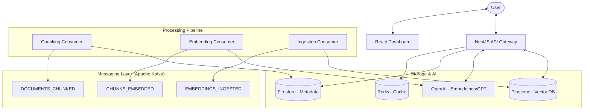

# RAGify 🚀

### Automated RAG-as-a-Service Platform

RAGify is a powerful platform designed to automate the creation of Retrieval-Augmented Generation (RAG) systems. It allows users to transform their documents into a production-ready, conversational API with minimal effort.

---

## 🌟 Key Features

- **Multi-Format Ingestion**: Support for PDF, CSV, and plain text documents.
- **Intelligent Processing**: Advanced semantic, fixed-size, and hybrid chunking strategies.
- **Event-Driven Architecture**: Highly scalable RAG pipeline powered by Apache Kafka.
- **Instant API Generation**: Automatically generates a dedicated API endpoint and keys for your project.
- **Custom Personas**: Tailor the LLM's response style, tone, and instructions.
- **Modern Dashboard**: Intuitive React interface for project and API key management.
- **Performance Caching**: Redis-backed project metadata caching for low-latency retrieval.

---

## 🏗️ Technology Stack

### 💻 Backend & Core
- **Framework**: [NestJS](https://nestjs.com/) (TypeScript) - Modular, scalable server-side architecture.
- **Messaging**: [Apache Kafka](https://kafka.apache.org/) - Handles asynchronous document processing pipelines.
- **Caching**: [Redis](https://redis.io/) - Low-latency storage for API keys and project metadata.

### 💾 Data & Vector Storage
- **Vector DB**: [Pinecone](https://www.pinecone.io/) - Specialized database for high-dimensional vector similarity search.
- **Metadata**: [Firebase Firestore](https://firebase.google.com/docs/firestore) - NoSQL database for project and user data.

### 🤖 Artificial Intelligence
- **Embeddings**: OpenAI `text-embedding-3-small` - Converts text into 512-dimensional vectors.
- **Generation**: OpenAI `gpt-3.5-turbo` / `gpt-4` - Large Language Models for RAG responses.

### 🎨 Frontend
- **Library**: [React 19](https://react.dev/) with [Vite](https://vitejs.dev/) - Modern, fast reactive UI.
- **State**: [Redux Toolkit](https://redux-toolkit.js.org/) - Robust state management for project flows.
- **Styling**: [Tailwind CSS v4](https://tailwindcss.com/) - Utility-first styling for a clean, modern dashboard.
- **Auth**: [Firebase Auth](https://firebase.google.com/docs/auth) - Secure, managed authentication.

### ☁️ Infrastructure & DevOps
- **Cloud**: AWS (Amazon Web Services).
- **IaC**: [Terraform](https://www.terraform.io/) - Automated provisioning of VPC, ECS, RDS, and IAM.
- **Containerization**: [Docker](https://www.docker.com/) - Consistent development and deployment environments.

---

## 🏗️ Architecture & System Design

RAGify is built with a decoupled, event-driven architecture to ensure high availability and scalability. The system is split into several core components that interact via a robust messaging layer.

### 🌐 High-Level Overview



### 🧠 Core Components

#### 1. API Gateway (NestJS)
The central entry point for both the dashboard and external RAG queries. It handles project management, API key validation, and serves as the orchestrator for real-time RAG generation.

#### 2. Event-Driven Pipeline (Apache Kafka)
To handle heavy document processing without blocking the API, RAGify uses Kafka-based workers:
- **Chunking Service**: Splits large documents into semantically meaningful chunks using recursive character splitting.
- **Embedding Service**: Batches chunks and generates high-dimensional vectors via OpenAI's `text-embedding-3-small`.
- **Ingestion Service**: Handles the final storage into Pinecone and performs metadata cleanup in Firestore.

#### 3. Data & Vector Storage
- **Firebase Firestore**: Stores project configurations, user metadata, and temporary document chunks.
- **Pinecone Vector Database**: High-performance vector index with project-level namespacing for isolated and fast semantic searches.
- **Redis Caching**: Caches project settings and API keys to minimize database lookups and ensure sub-100ms response times for query authorization.

#### 4. The RAG Query Flow
When a user queries the generated API:
1. **Auth**: The `ApiKeyGuard` verifies the token against the Redis cache.
2. **Retrieval**: The query is embedded, and a semantic search is performed in Pinecone to find the top-K relevant chunks.
3. **Augmentation**: The retrieved context is combined with the user's prompt and any existing conversation history.
4. **Generation**: OpenAI's GPT models generate a contextually accurate response based on the "Persona" defined for that project.

---

## 🚀 Getting Started

### Prerequisites
- Node.js (v18+)
- Docker (for Kafka, Redis, and Backend)
- Firebase Account (Firestore & Auth)
- Pinecone Account
- OpenAI API Key

### Installation

1. **Clone the repository**
   ```bash
   git clone https://github.com/shaked-shilo/RAGify.git
   cd RAGify
   ```

2. **Backend Setup**
   ```bash
   cd backend
   npm install
   # Copy .env.example to .env and fill in your credentials
   npm run dev
   ```

3. **Frontend Setup**
   ```bash
   cd ragify-frontend
   npm install
   # Configure Firebase environment variables
   npm run dev
   ```

4. **Infrastructure (Optional)**
   ```bash
   cd terraform
   terraform init
   terraform apply
   ```

---

## 📚 API Usage

RAGify provides a dedicated generation endpoint for your projects.

**Endpoint**: `POST /generation/generate`
**Headers**: `Authorization: Bearer <YOUR_API_KEY>`

**Payload**:
```json
{
  "projectId": "your-project-id",
  "prompt": "How does RAGify work?",
  "topK": 5
}
```

---

## 🛠️ Project Structure

- `/backend`: NestJS API and Kafka consumers.
- `/ragify-frontend`: React dashboard application.
- `/terraform`: AWS infrastructure configuration.

---

## 📄 License

This project is licensed under the MIT License - see the [LICENSE](LICENSE) file for details.
